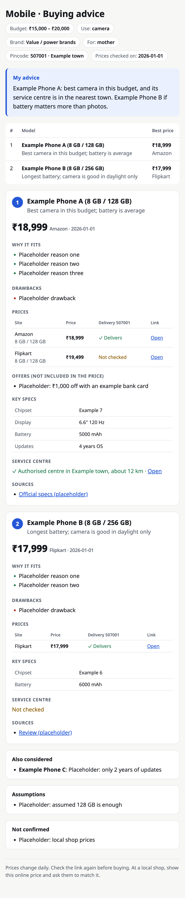

# Electronic shopping skill

An Agent Skill that helps you answer **"which phone is good under ₹20,000?"**, the question friends, family and
neighbours in Telangana and Andhra Pradesh keep asking. It covers **mobiles, laptops, TVs, ACs and
watches**.

You ask your coding agent (Claude Code or Codex). The skill makes it:

1. **Ask first:**
   - budget;
   - brand preference: trusted brands, value / power brands, a specific brand, or any;
   - main use: for example, a laptop for coding, interviews, basic use or gaming;
   - who it is for;
   - the delivery pincode.
2. **Research today's options** on Amazon, Flipkart, brand stores (Samsung, Dell, LG…) and large chains,
   and say when the local chains (Big C, Happi, Lot, Sangeetha, Bajaj Electronics) are worth checking.
3. **Check what matters locally:**
   - delivery and installation at the pincode;
   - the nearest authorised service centre;
   - AC sizing for 45 °C summers, coastal corrosion and unstable power.
4. **Hand back:**
   - a top 3 with prices from named sites, links and the date checked;
   - an **HTML report**;
   - a **WhatsApp message** to paste to whoever asked;
   - optionally a **PNG** of the report.

It never makes up a price, model or spec, never logs in or buys anything, and every price carries its
source link and date. The report builder refuses research that doesn't.



*The image uses the placeholder data from `assets/research.example.json`, not a real recommendation.*

## Install

```bash
git clone https://github.com/57hemanth/electronic-shopping-skill.git
cd electronic-shopping-skill
./install.sh            # links the skill into ~/.claude/skills and ~/.agents/skills
./install.sh --list     # what's installed where
./install.sh --uninstall
```

The skill is symlinked, so `git pull` updates it everywhere. Claude Code can also install it as a plugin:
`/plugin marketplace add 57hemanth/electronic-shopping-skill`, then `/plugin install electronic-shopping`.

## Use

Start a new session in any folder and ask:

- Claude Code: `/electronic-shopping`, or just ask "camera phone under ₹20,000 for my mother, pincode 507001".
- Codex: `$electronic-shopping`, or ask the same way.

It asks what it still needs, researches, and writes into `shopping/<date>-<category>-<slug>/` in the
current folder:

| File | What it is |
| --- | --- |
| `research.json` | Everything it found, with sources and dates |
| `report.html` | The report: top 3, prices per site, delivery, service centre, why / drawbacks, sources |
| `whatsapp.txt` | A short message to paste into WhatsApp |
| `report.png` | With `--png`: the report as one phone-width image |

### Browser (optional, recommended)

Web search covers models, specs and reviews. Live prices and **pincode delivery checks** on Amazon and
Flipkart need a browser:

- **Claude Code:** connect the Claude in Chrome extension. It uses your own
  Chrome, opens product pages in tabs, enters the pincode and reads the result.
- **Codex:** add a browser MCP server (for example Playwright or Chrome DevTools).

Without a browser, the skill still works and marks delivery as "not checked". In both cases it only
reads pages: no sign-in, no cart, no purchase, about 15 pages per request.

## Make it yours

All paths below are in `skills/electronic-shopping/`.

- **`references/brands.md`** holds the brand tiers (trusted vs value). They're opinions; edit them to
  match what you and people around you trust.
- **`references/regional.md`** holds the Telangana and Andhra specifics; add your district's quirks.
- The category files (`mobiles.md`, `laptops.md`, `tv.md`, `ac.md`, `watches.md`) list the budget
  ranges, use cases, specs to compare and traps.

## Repo layout

```
skills/electronic-shopping/
  SKILL.md                     the procedure: ask → research → decide → report
  references/                  category checklists, brands, sites, regional notes
  assets/research.example.json the research format (placeholder data)
  scripts/build_report.py      validates research, writes report.html, whatsapp.txt, report.png
scripts/validate_skills.py     checks the skill against the Agent Skills spec
tests/                         python3 -m unittest discover -s tests
install.sh                     symlinks into Claude Code and Codex
```

Everything is Python 3.10+ standard library; `--png` uses your local Chrome.

## Checks

```bash
python3 scripts/validate_skills.py
python3 -m unittest discover -s tests
```

## Limits

- **Prices and stock change daily,** and sale events change them a lot. The report is a snapshot with dates.
- **Local shop prices** can't be checked online. The advice is to show the online price at the shop and ask
  them to match it.
- **Two runs won't give the same answer:** search results and model output vary.
- **Brand tiers are one person's opinion.**
- **Not affiliated** with Amazon, Flipkart or any brand or store mentioned, and no affiliate links.

## Licence

No licence has been chosen yet, so all rights are reserved by default. Open an issue if you'd like to
reuse it.
